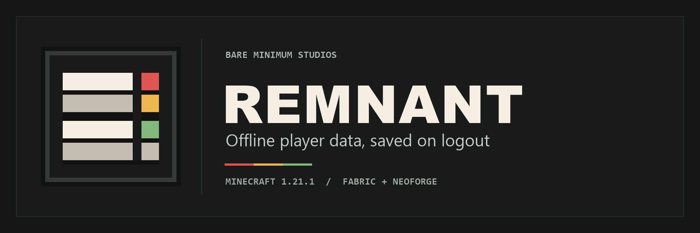

[](https://modrinth.com/mod/remnant) [](https://github.com/BareMinimumStudios/remnant#adding-remnant-to-a-project) [](https://github.com/BareMinimumStudios/remnant) [](https://github.com/BareMinimumStudios/remnant/issues) [](https://github.com/BareMinimumStudios/remnant/forks) [](https://github.com/BareMinimumStudios/remnant)

**Minecraft 1.21.1 · Fabric + NeoForge · Java 21**

Remnant keeps player data available to mods after players log out. It continues **Offline Player Cache (OPC)** as a server-side library for leaderboards, statistics, progression, and other integrations.

## How it works

- **Save data on logout.** Integrating mods register the values they need. Remnant stores captured values in Minecraft world data, so snapshots survive server restarts.
- **Return to live data on login.** Remnant clears the offline snapshot when the player rejoins. Integrations can look up players by UUID or case-insensitive username.
- **Manage snapshots in game.** Operators can inspect saved values, remove a key, or clear a player's offline snapshot.

## Installation

- **Fabric 1.21.1** — requires Fabric API and Fabric Language Kotlin
- **NeoForge 1.21.1** — requires Kotlin for Forge
- **Java 21**

Install the JAR for your loader and the dependencies above on the server. Integrating mods supply the values used by leaderboards, stats, and other features.

## Commands

All commands require permission level 2.

```text
/remnant keys
/remnant players

/remnant get name <name> <key>
/remnant get uuid <uuid> <key>

/remnant list name <name>
/remnant list uuid <uuid>

/remnant remove name <name> <key>
/remnant remove uuid <uuid> <key>

/remnant clear name <name>
/remnant clear uuid <uuid>
```

`get` and `list` read live values for online players and saved values for offline players. Lookups support UUIDs and case-insensitive usernames. `remove` and `clear` only modify offline snapshots.

## For developers

A registered value is identified by a `ResourceLocation`, serialized with a Mojang `Codec`, and produced from a live `Player`.

```java
public static final PlayerLedgerKey<Contract> CONTRACT = PlayerLedger.register(
    ResourceLocation.fromNamespaceAndPath("example", "contract"),
    Contract.CODEC,
    player -> new Contract(player.getName().getString(), true)
);
```

Use `PlayerLedger.getPlayer(...)` with a UUID or username to read a live player or an offline snapshot. It throws `IllegalStateException` when neither is available. Use `getOfflinePlayer(...)` for a cache-only lookup that returns `null` when there is no snapshot.

See the [GitHub README for API examples and Maven setup](https://github.com/BareMinimumStudios/remnant#adding-remnant-to-a-project).

## License

Remnant is licensed under the **Bare Minimum License (BML) v1.1**. See the [full license](https://github.com/BareMinimumStudios/remnant/blob/HEAD/LICENSE).

## Sponsor

[](https://bisecthosting.com/bareminimum)

Use code **`bareminimum`** to get **25% off your first month**!
